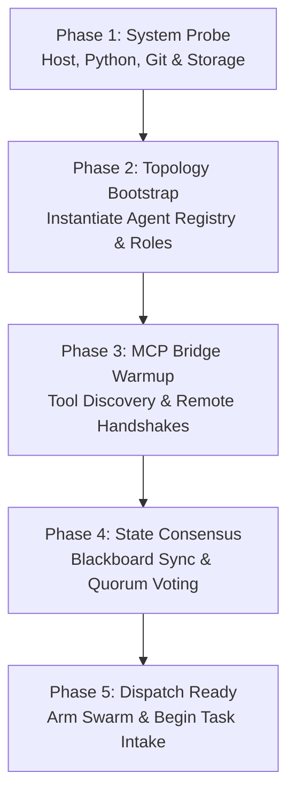

# Project ANTIGRVITY

[](https://www.python.org/downloads/)
[](https://opensource.org/licenses/Apache-2.0)
[](https://modelcontextprotocol.io/)

Multi-Agent Cold-Start Orchestration Framework and Model Context Protocol (MCP) Bridge for autonomous multi-agent swarms.

```
+----------------------------------------------------------------------------------------------------+
|                                      PROJECT ANTIGRVITY                                            |
|                                                                                                    |
|  [ Cold-Start Deployment v2 ]                [ Multi-Agent Swarm ]             [ MCP Bridge ]      |
|  - Technical Zero Context Load               - Coordinator_Zero (Lead)         - Notebook Bridge   |
|  - 100-Token Eviction Policy                 - Executor_Zero (Worker)          - Blackboard RPC    |
|  - Short-Term Buffer Pruning                 - Observer_Zero (Auditor)         - rentahuman.ai API |
|  - Working Memory Compression                - Consensus Quorum Engine         - Stdio / HTTP      |
+----------------------------------------------------------------------------------------------------+
```

---

## 1. Quickstart

### A. Run Custom Cold-Start with 100-Token Eviction Policy
To execute the managed cold-start simulation with technical zero context load and strict context eviction:
```sh
python cold_start_deployment-v2.py
```

### B. Run Full Swarm Cold-Start Bootstrap
To initiate the 5-phase swarm cold-start pipeline:
```sh
python -m antigrvity.cli coldstart
```

### C. Launch Native MCP Stdio Server
To expose the internal tools over Model Context Protocol (MCP):
```sh
python -m antigrvity.cli mcp-server
```

### D. Run Complete Test Suite
```sh
python -m unittest discover tests
```

---

## 2. Architecture & Components

### A. Managed Cold-Start Runtime & 100-Token Eviction (`cold_start_deployment-v2.py`)
Agents initialize at **Technical Zero Context Load** (solely their baseline system prompt tokens). As stimulus and responses cycle through the multi-agent mesh, the active eviction policy guards against context drift and memory explosion:
- **Phase 1: Buffer Pruning**: Frees oldest short-term buffer items when cumulative tokens exceed 100.
- **Phase 2: Hard Context Cap**: Guarantees working memory remains strictly $\le 100$ tokens.
- **Eviction Telemetry**: Emits structured timestamped eviction logs capturing token count before/after.

### B. MCP Bridge Subsystem (`config.toml` & `config/mcp_servers.json`)
The MCP Bridge multiplexes downstream external services and internal diagnostic tools:
- **Notebook MCP Bridge**: Configured via [config.toml](file:///c:/Users/DRVJP/Desktop/ANTIGRAVITY%20+%20NOTEBOOK%20PROJECT/ANTIGRVITY/config.toml) pointing to `http://rentahuman.ai` with bearer authentication.
- **Internal Tools**: Blackboard inspection/modification, swarm dispatch, and stateful notebook kernel execution.
- **Antigravity IDE Integration**: Configured in [.agents/mcp_config.json](file:///c:/Users/DRVJP/Desktop/ANTIGRAVITY%20+%20NOTEBOOK%20PROJECT/ANTIGRVITY/.agents/mcp_config.json).

### C. 5-Phase Cold-Start Orchestration Pipeline


---

## 3. Directory Layout

```
ANTIGRVITY/
├── .agents/
│   ├── rules/
│   │   └── AGENTS.md                  # Master multi-agent workspace rules
│   ├── skills/
│   │   ├── cold-start-orchestrator/   # Skill for bootstrapping swarms
│   │   │   └── SKILL.md
│   │   └── mcp-bridge/                # Skill for MCP operations
│   │       └── SKILL.md
│   ├── mcp_config.json                # IDE / CLI MCP bridge configuration
│   └── skills.json                    # Explicit skills manifest
├── config.toml                        # External MCP server definitions (notebook bridge)
├── cold_start_deployment-v2.py        # 100-token eviction cold-start deployment script
├── config/
│   ├── agents.json                    # Swarm topology & role specifications
│   ├── coldstart.json                 # 5-phase cold-start rules & timeouts
│   └── mcp_servers.json               # Downstream MCP servers
├── antigrvity/
│   ├── cli.py                         # CLI entrypoint
│   ├── core/                          # Blackboard, events, config, exceptions
│   ├── agents/                        # BaseAgent, Registry, Orchestrator, Reviewer
│   ├── orchestration/                 # ColdStartEngine, ConsensusEngine, TaskDAG
│   ├── mcp/                           # JSON-RPC 2.0 protocol, MCPServer, MCPBridge
│   └── utils/                         # Structured logging, system probes
├── tests/                             # Full unit & integration test suite (12 tests)
├── GEMINI.md                          # Workspace rules
└── pyproject.toml                     # Python package definition
```

---

## 4. License
Apache License 2.0. See LICENSE for details.
